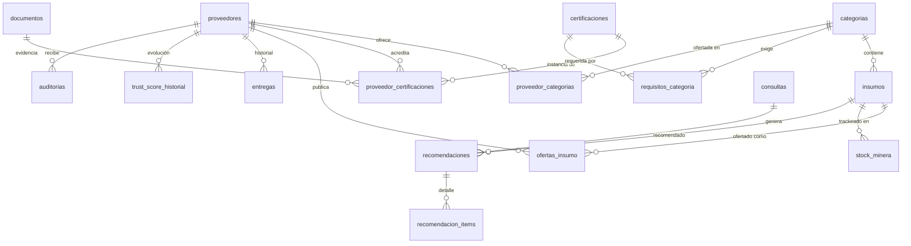

# Schema de base de datos — Supabase (Postgres)

Parte de la documentación de ju-min — índice en [DOCS.md](DOCS.md).


### 4.1 Decisiones

- **Naming en español** (consistente con el dominio del README: `Proveedor`,
  `OfertaInsumo`, `StockMinera`, `Consulta`) → tablas en `snake_case` español.
- **Catálogos normalizados**: `certificaciones` y `categorias` son catálogos;
  la relación proveedor↔certificación es una tabla puente con metadatos
  (vencimiento, evidencia, estado). Nunca texto libre para algo que se filtra.
- **Certificación vs. insumo vs. proveedor son cosas distintas**: la
  certificación puede acreditar a la empresa (ISO 9001) o a un producto
  (IRAM-EPP). Se modela con `ambito` en el catálogo.
- **Documentos como primera clase**: todo lo verificable referencia un
  documento en Supabase Storage (bucket `documentos`, privado con URLs
  firmadas). Un certificado "declarado" sin PDF ≠ certificado validado.
- **Evidencia de fuente**: campos `fuente` y `fuente_url` en `proveedores`
  para trazar de dónde salió cada registro (CAPMIN, registro Jujuy, manual).
- **RLS**: lectura pública de catálogo de proveedores homologados; escritura
  solo service role. Para la demo puede quedar deshabilitado, pero el esquema
  lo admite.
- **UUIDs** + `timestamptz`, `created_at`/`updated_at` en todo.
- `tsvector`/extensión `pg_trgm` para búsqueda por razón social/categoría.

### 4.2 Diagrama ER



### 4.3 DDL propuesto

```sql
-- ============================ ENUMS ============================

create type estado_proveedor as enum
  ('registrado', 'documentado', 'validado', 'auditado', 'homologado', 'suspendido');

create type estado_verificacion as enum
  ('declarado', 'en_revision', 'verificado', 'rechazado', 'vencido');

create type ambito_certificacion as enum
  ('empresa', 'producto', 'proceso', 'persona');

create type tipo_certificacion as enum
  ('sistema_gestion', 'producto', 'habilitacion_regulatoria', 'esg', 'registro');

create type estado_consulta as enum
  ('pendiente', 'aprobada', 'rechazada');

create type condicion_iva as enum
  ('responsable_inscripto', 'monotributo', 'exento', 'no_responsable', 'desconocido');

-- ============================ CATÁLOGOS ============================

create table categorias (
  id          uuid primary key default gen_random_uuid(),
  nombre      text not null unique,               -- "Venta de EPP", "Lubricantes", "Explosivos"
  slug        text not null unique,
  categoria_padre_id uuid references categorias(id),  -- jerarquía opcional (CAPMIN tiene ~180 planas; agrupables)
  origen      text,                               -- 'capmin' | 'caem' | 'manual'
  created_at  timestamptz not null default now()
);

create table certificaciones (
  id          uuid primary key default gen_random_uuid(),
  nombre      text not null,                      -- "ISO 9001:2015"
  codigo      text,                               -- "ISO 9001", "GRI-GM13", "IRAM-ISO 14001"
  tipo        tipo_certificacion not null,
  ambito      ambito_certificacion not null,      -- empresa | producto | proceso | persona
  organismo_tipico text,                          -- "IRAM", "DNV", "ANMaC", "Registro Prov. Jujuy"
  descripcion text,
  created_at  timestamptz not null default now(),
  unique (codigo, ambito)
);

-- Qué exige cada categoría de insumo (regla de homologación)
create table requisitos_categoria (
  id              uuid primary key default gen_random_uuid(),
  categoria_id    uuid not null references categorias(id) on delete cascade,
  certificacion_id uuid not null references certificaciones(id),
  obligatorio     boolean not null default true,  -- false = suma puntos pero no bloquea
  unique (categoria_id, certificacion_id)
);

-- ============================ PROVEEDORES ============================

create table proveedores (
  id                  uuid primary key default gen_random_uuid(),
  razon_social        text not null,
  nombre_fantasia     text,
  cuit                text unique,                  -- "30-12345678-9"
  condicion_iva       condicion_iva default 'desconocido',
  fecha_constitucion  date,                         -- antigüedad fiscal (cuitonline)
  domicilio           text,
  localidad           text,
  provincia           text,
  pais                text not null default 'AR',
  lat                 double precision,
  lng                 double precision,             -- geocodificado (Nominatim)
  sitio_web           text,
  email               text,
  telefono            text,
  provincias_operacion text[],                      -- CAEM: "provincias donde opera"
  estado              estado_proveedor not null default 'registrado',
  registro_jujuy_estado text,                       -- 'aprobado' | 'pendiente' | null
  fuente              text not null default 'manual', -- 'capmin' | 'caem' | 'registro_jujuy' | 'manual'
  fuente_url          text,
  trust_score         numeric(5,2),                 -- 0-100, calculado
  trust_score_detalle jsonb,                        -- desglose por grupo de señales
  created_at          timestamptz not null default now(),
  updated_at          timestamptz not null default now()
);
create index on proveedores using gin (razon_social gin_trgm_ops);

create table contactos_proveedor (
  id           uuid primary key default gen_random_uuid(),
  proveedor_id uuid not null references proveedores(id) on delete cascade,
  nombre       text not null,
  rol          text,
  email        text,
  telefono     text
);

create table proveedor_categorias (
  proveedor_id uuid not null references proveedores(id) on delete cascade,
  categoria_id uuid not null references categorias(id) on delete cascade,
  primary key (proveedor_id, categoria_id)
);

-- Documentos: certificados, seguros, constancias. El archivo vive en Storage.
create table documentos (
  id           uuid primary key default gen_random_uuid(),
  proveedor_id uuid not null references proveedores(id) on delete cascade,
  tipo         text not null,            -- 'certificado' | 'seguro' | 'constancia_fiscal' | 'auditoria' | 'otro'
  storage_path text not null,            -- path en bucket 'documentos'
  nombre_archivo text,
  created_at   timestamptz not null default now()
);

-- Instancia: este proveedor tiene esta certificación, con evidencia y vigencia
create table proveedor_certificaciones (
  id               uuid primary key default gen_random_uuid(),
  proveedor_id     uuid not null references proveedores(id) on delete cascade,
  certificacion_id uuid not null references certificaciones(id),
  numero_certificado text,
  organismo        text,                  -- quien la emitió realmente
  fecha_emision    date,
  fecha_vencimiento date,
  alcance          text,                  -- texto del alcance del certificado
  estado           estado_verificacion not null default 'declarado',
  documento_id     uuid references documentos(id),
  created_at       timestamptz not null default now(),
  unique (proveedor_id, certificacion_id, numero_certificado)
);

create table auditorias (
  id           uuid primary key default gen_random_uuid(),
  proveedor_id uuid not null references proveedores(id) on delete cascade,
  fecha        date not null,
  tipo         text,                      -- 'presencial' | 'remota'
  auditor      text,                      -- organismo o interno
  puntaje      numeric(5,2),
  informe_documento_id uuid references documentos(id),
  resultado    text,                      -- 'aprobado' | 'con_observaciones' | 'rechazado'
  created_at   timestamptz not null default now()
);

-- ============================ INSUMOS Y OFERTAS ============================

create table insumos (
  id           uuid primary key default gen_random_uuid(),
  categoria_id uuid not null references categorias(id),
  nombre       text not null,             -- "Bola de acero forjado 3\""
  unidad       text not null,             -- 'kg', 'unidad', 'litro', 'm2'
  especificacion text,                    -- spec técnica opcional
  created_at   timestamptz not null default now()
);

create table ofertas_insumo (
  id            uuid primary key default gen_random_uuid(),
  proveedor_id  uuid not null references proveedores(id) on delete cascade,
  insumo_id     uuid not null references insumos(id) on delete cascade,
  precio        numeric(14,2) not null,
  moneda        text not null default 'ARS',
  lead_time_dias int,
  disponible    boolean not null default true,
  vigente_desde date default current_date,
  vigente_hasta date,
  created_at    timestamptz not null default now(),
  unique (proveedor_id, insumo_id)
);

-- ============================ MINERA / STOCK ============================

create table mineras (
  id        uuid primary key default gen_random_uuid(),
  nombre    text not null,                -- "Sales de Jujuy"
  ubicacion text,
  created_at timestamptz not null default now()
);

create table stock_minera (
  id                uuid primary key default gen_random_uuid(),
  minera_id         uuid not null references mineras(id) on delete cascade,
  insumo_id         uuid not null references insumos(id) on delete cascade,
  cantidad_actual   numeric(14,3) not null,
  punto_reorden     numeric(14,3) not null,
  consumo_mensual   numeric(14,3),
  updated_at        timestamptz not null default now(),
  unique (minera_id, insumo_id)
);

-- ============================ AGENTE: CONSULTAS Y RECOMENDACIONES ============================

create table consultas (
  id            uuid primary key default gen_random_uuid(),
  minera_id     uuid references mineras(id),
  mensaje       text not null,            -- input del usuario
  respuesta     text,                     -- output del agente
  estado        estado_consulta not null default 'pendiente',
  created_at    timestamptz not null default now()
);

create table recomendaciones (
  id              uuid primary key default gen_random_uuid(),
  consulta_id     uuid not null references consultas(id) on delete cascade,
  proveedor_id    uuid references proveedores(id),
  insumo_id       uuid references insumos(id),
  justificacion   text,                   -- por qué lo recomendó (precio, lead time, trust score, certs)
  puntaje         numeric(5,2),
  created_at      timestamptz not null default now()
);

-- Historial para el trust score: entregas reales o simuladas
create table entregas (
  id               uuid primary key default gen_random_uuid(),
  proveedor_id     uuid not null references proveedores(id) on delete cascade,
  insumo_id        uuid references insumos(id),
  fecha_compromiso date,
  fecha_entrega    date,
  a_tiempo         boolean generated always as (fecha_entrega <= fecha_compromiso) stored,
  conforme         boolean,
  created_at       timestamptz not null default now()
);

create table trust_score_historial (
  id           uuid primary key default gen_random_uuid(),
  proveedor_id uuid not null references proveedores(id) on delete cascade,
  puntaje      numeric(5,2) not null,
  detalle      jsonb,                      -- snapshot del desglose
  created_at   timestamptz not null default now()
);
```

### 4.4 Extensiones y extras de Supabase

```sql
create extension if not exists pg_trgm;      -- búsqueda difusa por nombre
create extension if not exists postgis;      -- opcional: si el mapa filtra por distancia
```

- **Bucket `documentos`** (privado): certificados, seguros, informes de
  auditoría. Se accede con signed URLs.
- **Vista útil para el explorer**:

```sql
create view proveedores_explorer as
select p.id, p.razon_social, p.cuit, p.provincia, p.lat, p.lng,
       p.estado, p.trust_score, p.registro_jujuy_estado,
       array_agg(distinct c.nombre) as categorias,
       count(distinct pc.certificacion_id)
         filter (where pc.estado = 'verificado'
                 and (pc.fecha_vencimiento is null or pc.fecha_vencimiento > now()))
         as certificaciones_vigentes
from proveedores p
left join proveedor_categorias pk on pk.proveedor_id = p.id
left join categorias c on c.id = pk.categoria_id
left join proveedor_certificaciones pc on pc.proveedor_id = p.id
group by p.id;
```

- **Chequeo de homologación** (regla del agente) como función:

```sql
create or replace function cumple_requisitos(p_proveedor uuid, p_categoria uuid)
returns boolean language sql stable as $$
  select not exists (
    select 1
    from requisitos_categoria rc
    where rc.categoria_id = p_categoria and rc.obligatorio
      and not exists (
        select 1 from proveedor_certificaciones pc
        where pc.proveedor_id = p_proveedor
          and pc.certificacion_id = rc.certificacion_id
          and pc.estado = 'verificado'
          and (pc.fecha_vencimiento is null or pc.fecha_vencimiento > current_date)
      )
  );
$$;
```

---


## 6. Mapeo: mocks del README → tablas

| Mock actual | Tabla(s) |
|---|---|
| `Proveedor` (nombre, CUIT, ubicación, certificaciones, trust score, contacto) | `proveedores` + `contactos_proveedor` + `proveedor_certificaciones` |
| `OfertaInsumo` (insumo, precio, unidad, lead time, disponibilidad) | `insumos` + `ofertas_insumo` |
| `StockMinera` (cantidad, punto de reorden, consumo mensual) | `stock_minera` + `mineras` |
| `Consulta` (mensaje, respuesta, recomendaciones, estado, timestamp) | `consultas` + `recomendaciones` |
| "red verificada" / trust score | `proveedores.estado` + `trust_score` + `trust_score_historial` + `auditorias` |

---

