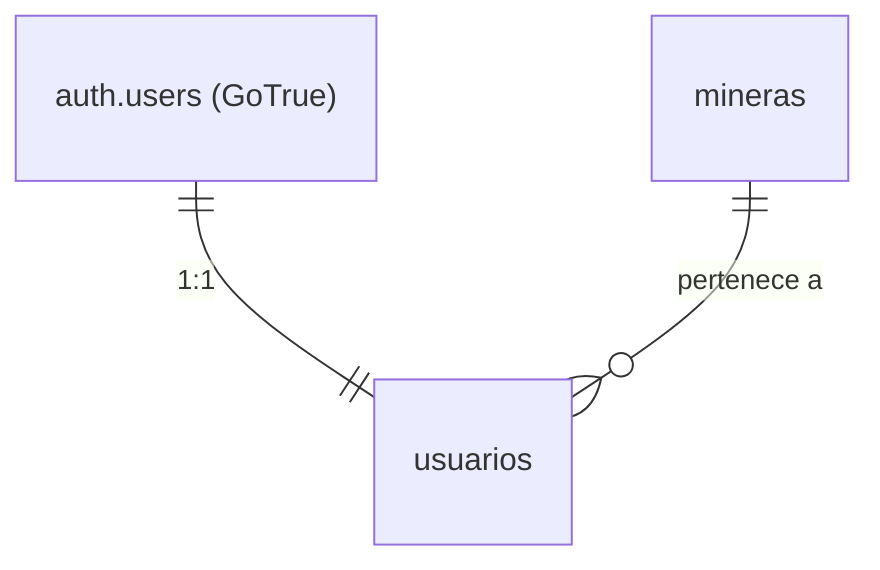

# Usuarios y autenticación — email/password sobre Supabase Auth

Parte de la documentación de ju-min — índice en [DOCS.md](DOCS.md).

Modelo de usuarios sobre **Supabase Auth** (GoTrue). La autenticación
email/password la maneja `auth.users`; el dominio agrega un perfil 1:1 en
`public.usuarios` con rol y minera. **No hay página de login** — la app consume
la API de auth directamente (ver §Uso).

## Modelo



- **`auth.users`** — email, password hasheado (bcrypt), sesiones/JWT,
  metadata (`raw_user_meta_data`). Gestionado por Supabase, no tocar.
- **`public.usuarios`** — perfil de dominio:
  `id` (FK a `auth.users`, cascade), `minera_id` (FK a `mineras`),
  `nombre`, `rol`, timestamps.

### Trigger de perfil automático

`handle_new_user()` (security definer) corre `after insert on auth.users` y
crea la fila en `usuarios` leyendo `raw_user_meta_data`:

```ts
// El frontend pasa los datos de perfil al registrarse:
supabase.auth.signUp({
  email,
  password,
  options: { data: { nombre: 'Julián Paredes', rol: 'comprador', minera_id: '<uuid>' } },
});
```

Sin metadata cae a defaults: `nombre` = parte local del email,
`rol` = `comprador`, `minera_id` = null.

## Roles

| Rol | Puede |
|---|---|
| `admin` | Todo lo de su minera + aprobar/rechazar consultas |
| `comprador` | Leer stock/consultas/recomendaciones de su minera, crear consultas |
| `aprobador` | Igual que comprador + puede cambiar estado de consultas (aprobar/rechazar) |

Los perfiles de usuario se listan entre compañeros de minera (un usuario ve su
perfil y el de los miembros de su misma minera). Editar: solo el propio perfil;
rol y minera los cambia el service role.

## RLS

RLS activo en `usuarios`, `mineras`, `stock_minera`, `consultas`,
`recomendaciones`. Las policies usan dos helpers **security definer** (evitan
recursión al leer `usuarios` dentro de una policy de `usuarios`):

- `public.auth_minera_id()` → minera del usuario autenticado
- `public.auth_rol()` → rol del usuario autenticado

| Tabla | authenticated puede |
|---|---|
| `usuarios` | SELECT propio + compañeros de minera; UPDATE solo su fila |
| `mineras` | SELECT solo su minera |
| `stock_minera` | SELECT solo de su minera |
| `consultas` | SELECT/INSERT de su minera; UPDATE solo `admin`/`aprobador` |
| `recomendaciones` | SELECT si la consulta es de su minera |
| catálogo + red verificada | heredan policies públicas de la migración `00010` |
| `documentos`, `entregas`, `auditorias`, `trust_score_historial` | service role |

## Usuarios sembrados

`seed.sql` inserta directo en `auth.users` + `auth.identities` (el trigger les
crea el perfil). Password de todos: **`ju-min-demo`**.

| Email | Rol | Minera |
|---|---|---|
| `admin@salesdejujuy.ju-min.local` | admin | Sales de Jujuy S.A. |
| `comprador@salesdejujuy.ju-min.local` | comprador | Sales de Jujuy S.A. |
| `aprobador@salesdejujuy.ju-min.local` | aprobador | Sales de Jujuy S.A. |

## Uso (sin página de login)

Registro:

```bash
curl -X POST "$SUPABASE_URL/auth/v1/signup" \
  -H "apikey: $ANON_KEY" -H "Content-Type: application/json" \
  -d '{"email":"nuevo@minera.ju-min.local","password":"ju-min-demo",
       "data":{"nombre":"Nombre","rol":"comprador","minera_id":"<uuid-minera>"}}'
```

Login:

```bash
curl -X POST "$SUPABASE_URL/auth/v1/token?grant_type=password" \
  -H "apikey: $ANON_KEY" -H "Content-Type: application/json" \
  -d '{"email":"comprador@salesdejujuy.ju-min.local","password":"ju-min-demo"}'
# → { "access_token": "...", "refresh_token": "...", "user": {...} }
```

Queries autenticadas: header `Authorization: Bearer <access_token>` — las RLS
aplican automáticamente (el JWT lleva `role: authenticated` y `sub: user.id`).

```ts
// con supabase-js el flujo es el mismo
const { data } = await supabase.auth.signInWithPassword({ email, password });
await supabase.from('consultas').select('*'); // solo las de su minera
```

## Config relevante (`supabase/config.toml`)

- `auth.enable_signup = true`, `auth.email.enable_signup = true`
- `auth.email.enable_confirmations = false` → login inmediato tras signup
  (los mails de confirmación caerían en Mailpit `:54324` si se activan)
- `jwt_expiry = 3600` — el access token dura 1 h; usar refresh token
- `minimum_password_length = 6`

## Caveats

- **Service role ignora RLS** — el backend/agente operan con service key y ven
  todo; las policies aplican a anon y authenticated.
- Un usuario sin `minera_id` ve la red verificada pero nada de datos de minera.
- El trigger no valida que `minera_id` exista en metadata — un uuid inválido
  deja `minera_id` en null (el FK no se viola porque se castea con `nullif`);
  asignarlo después via service role.
